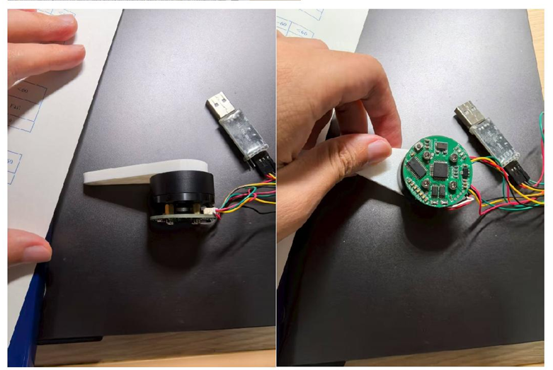

# STM32F103 + SimpleFOC：从开环到三环的无刷电机矢量控制

基于 **STM32F103C8T6 + STM32 HAL** 的无刷电机 FOC 控制项目，参考 SimpleFOC 的算法结构，按 **开环 → 速度 / 位置闭环 → 电流环 → 三环可切换** 整理为四个独立工程。

覆盖磁编码器反馈、SVPWM、电流采样、PID 与串口调参，提供 CubeMX 配置和 Keil 工程，便于沿着控制链路阅读代码、调试硬件与对比不同控制模式。


**[实物展示](#实物展示) · [工程导航](#四个工程四条演进线) · [快速开始](#快速开始) · [接线表](#接线表) · [串口调参](#串口调参与遥测)**

## 实物展示



电机与驱动板的两个视角，展示电机装配、圆形电路板及 USB 转串口连接。图片随页面直接加载，无需展开或跳转。

| 控制算法 | 传感与采样 | 工程实现 |
| --- | --- | --- |
| SVPWM、Clarke / Park 变换、位置 / 速度 / 电流控制 | AS5600 角度反馈、双通道 ADC + DMA | STM32 HAL、CubeMX + Keil、串口参数调整与遥测 |

### 从开环到三环


实物照片用于展示硬件形态；具体控制模式、引脚与参数以对应工程代码为准。

---

## 目录

- [它做了什么](#它做了什么)
- [四个工程，四条演进线](#四个工程四条演进线)
- [硬件准备](#硬件准备)
- [接线表](#接线表)
- [快速开始](#快速开始)
- [串口调参与遥测](#串口调参与遥测)
- [代码结构](#代码结构)
- [关键参数](#关键参数)
- [建议的整定顺序](#建议的整定顺序)
- [已知问题与可改进项](#已知问题与可改进项)
- [致谢与许可](#致谢与许可)

---

## 它做了什么

- **SVPWM 调制**：`setPhaseVoltage()` 把 `Uq/Ud` 经反 Park 变换成三相占空比，按扇区计算作用时间后写入 TIM2 的三个通道。
- **电流采样**：两相下桥臂 0.01 Ω 采样电阻 + 50 倍放大，ADC1 双通道 + DMA 循环搬运，上电做偏置标定。
- **Clarke / Park 变换**：`getFOCCurrents()` 从相电流算 `id/iq`，速度环、电流环都跑在这套坐标下。
- **两种转矩源**：电压模式（`Type_voltage`）与 FOC 电流模式（`Type_foc_current`），运行时可切换。
- **三种控制目标**：力矩、速度、位置（角度），位置环输出作为速度环给定，速度环输出作为转矩给定。
- **磁编码器反馈**：AS5600 通过 I2C 读取 12 位绝对角度，代码里做了多圈累加和差分测速。
- **串口调参**：不用反复烧录，直接发一条串口命令改 PID 或目标值，同时回传实时曲线数据。

## 四个工程，四条演进线

| 目录 | 控制方式 | 用到的外设 | 说明 |
| --- | --- | --- | --- |
| `mysimplefoc1-开环` | `Type_velocity_openloop` / `Type_angle_openloop` | TIM2、USART1 | 不接编码器，直接按目标速度产生旋转电压矢量，用来验证三相桥、相序、极对数和 PWM 频率 |
| `mysimplefoc1-闭环` | 速度环 / 位置环（电压转矩） | + I2C1（AS5600） | 加入磁编码器与 `alignSensor()` 电角度对齐，速度环 PI、位置环 PD 闭环 |
| `mysimplefoc1-电流` | 位置环 → 速度环 → **电流环** | + ADC1 + DMA | 增加在线电流采样与 `id/iq` 双 PI，转矩由电流环给，低速平稳性和力矩线性度明显好于纯电压模式 |
| `mysimplefoc1-电流 - 三环选择` | 位置环 → 速度环 → 电流环（可切电压环） | 同上 | 用串口命令 `T` / `t` 在「带电流环」和「纯电压环」之间切换，方便对比两种转矩源的手感差异 |

四个目录的 `Core/Src` 是各自独立的完整副本（CubeMX 工程之间的常规做法），想对比改动可以直接 diff 两个目录里的 `BLDCMotor.c` 与 `main.c`。

## 硬件准备

| 部件 | 说明 |
| --- | --- |
| 主控 | STM32F103C8T6 最小系统板（Blue Pill），8 MHz 外部晶振，PLL ×9 → 72 MHz |
| 驱动 | 三相半桥（带使能脚），栅极驱动接 TIM2 CH2/CH3/CH4 |
| 电机 | 云台无刷电机，**极对数 7**（代码里 `pole_pairs=7`，换电机必须改这里） |
| 编码器 | AS5600 磁编码器，I2C 接口，地址 `0x36` |
| 电流采样 | 两相下桥臂 0.01 Ω 采样电阻 + 50 倍运放，输出接 PA7 / PB0 |
| 电源 | 12 V（`voltage_power_supply=12`），驱动板与主控共地 |
| 调试 | ST-Link（SWD）、USB-TTL 串口模块（115200 8N1） |

> 代码按「一台 12 V / 7 对极云台电机 + 双电阻采样」的配置写好参数，换硬件时需要同步改极对数、`voltage_limit`、采样电阻与放大倍数。

## 接线表

| 功能 | 引脚 | 外设配置 |
| --- | --- | --- |
| A 相 PWM | PA1 | TIM2_CH2 |
| B 相 PWM | PA2 | TIM2_CH3 |
| C 相 PWM | PA3 | TIM2_CH4 |
| 驱动使能 | PA4 | GPIO 输出，高电平使能（`M1_Enable`） |
| 电流采样 A 相 | PA7 | ADC1_IN7 |
| 电流采样 B 相 | PB0 | ADC1_IN8 |
| AS5600 SCL / SDA | PB6 / PB7 | I2C1 |
| 预留 I2C2 | PB10 / PB11 | I2C2（当前未使用） |
| 串口 TX / RX | PA9 / PA10 | USART1，115200 |
| 状态指示 | PC13 | GPIO 输出（板载 LED） |
| 调试口 | PA13 / PA14 | SWDIO / SWCLK |

PWM 频率：72 MHz / (1439 + 1) = **50 kHz**；ADC 采样时间 1.5 周期，连续转换 + DMA 循环。

## 快速开始

1. 用 STM32CubeMX 6.6.1 打开对应目录的 `mysimplefoc1.ioc`（固件包 FW_F1 V1.8.5）可查看/修改外设配置；只改代码时不需要重新生成。
2. 用 **Keil MDK 5** 打开 `MDK-ARM/mysimplefoc1.uvprojx`，编译。
   - 仓库里提交了 `.o/.crf/.axf` 等中间产物，首次编译建议先 **Project → Clean Targets**，避免链接到旧对象文件。
   - 需要安装 STM32F1 系列的 Device Family Pack。
3. ST-Link 下载，接 USB-TTL 到 PA9/PA10，串口 115200 打开。
4. 上电后串口会打印标定信息（如 `gain_a/gain_b` 与 `offset_ia/offset_ib`），随后周期性输出遥测，形如：

```
target , voltageq , -velocity , -angle , P_angle_P
0.000 , 0.812 , 0.034 , 1.279 , 2.000
```

5. 发命令改目标值，例如 `T3.14` 让位置环走到 π，`V20` 改速度限幅。

> ⚠️ 先架空电机再上电。开环工程在未对齐相序时可能原地抖动或堵转发热，电流工程如果采样偏置没标定好会出现持续大电流。

## 串口调参与遥测

协议很简单：一个字母 + 数值 + 换行（`\n`），串口工具需发送换行符。

| 命令 | 含义 | 影响的变量 |
| --- | --- | --- |
| `P<val>` | 位置环 P | `P_angle.P` |
| `I<val>` | 位置环 I | `P_angle.I` |
| `D<val>` | 位置环 D | `P_angle.D` |
| `V<val>` | 速度限幅 / 速度目标 | `velocity_limit`、`target_v` |
| `C<val>` | 电流限幅 | `current_limit` |
| `T<val>` | 位置目标，且转矩源=**电流环** | `target`、`torque_controller=Type_foc_current` |
| `t<val>` | 位置目标，且转矩源=**电压环** | `target`、`torque_controller=Type_voltage` |

每条命令都会回显 `RX=<val>`，方便确认收到。

## 代码结构

以 `mysimplefoc1-电流 - 三环选择` 为例（其余工程是它的子集）：

```
Core/
├── Inc/  MyProject.h        总头文件：统一引入外设与算法模块，定义使能宏
├── Src/
│   ├── main.c               外设初始化、串口命令解析、参数设定、主循环
│   ├── BLDCMotor.c          FOC 核心：Motor_init / alignSensor / loopFOC / move / setPhaseVoltage
│   ├── FOCMotor.c           电机基类：电压、速度、角度限制
│   ├── foc_utils.c          _sin / _cos / _sqrt 快速实现与角度归一化
│   ├── pid.c                PID 结构体与控制器
│   ├── lowpass_filter.c     一阶低通，用于速度环反馈
│   ├── MagneticSensor.c     AS5600 读角度、多圈累加、差分测速
│   ├── InlineCurrentSense.c 在线电流采样、偏置标定、相电流换算
│   ├── CurrentSense.c       Clarke / Park 变换，输出 id/iq 与合成电流
│   └── adc.c / dma.c / i2c.c / tim.c / usart.c / gpio.c   CubeMX 外设初始化
└── MDK-ARM/                 Keil 工程、启动文件、编译产物
```

主循环只有两步（下面是简化示意，实际循环里还有串口遥测与转矩源切换）：

```c
while (1) {
    move(target);   // 位置/速度/力矩外环 + 转矩给定
    loopFOC();      // 读传感器 → 电角度 → id/iq → SVPWM
}
```

## 关键参数

| 参数 | 值 | 位置 |
| --- | --- | --- |
| `voltage_power_supply` | 12 V | main.c |
| `voltage_limit` | 6 V（开环为 2.5 V） | main.c |
| `pole_pairs` | 7 | main.c |
| `voltage_sensor_align` | 2 V（三环工程）/ 2.5 V（闭环工程），对齐用 | main.c |
| 位置环 PID | P=2.0，D=0.1，限幅=速度限幅 | main.c |
| 速度环 PID | 开环电压：P=0.1 / I=0.01；电流环：P=0.05 / I=0.001 | main.c |
| 电流环 PI | q 轴 P=60 / I=1，d 轴 P=20 / I=0.3 | main.c |
| 速度输出斜坡 | `output_ramp=40` | main.c |
| 速度低通 | `Tf=0.005 s` | main.c |
| 采样电阻 / 放大 | 0.01 Ω / 50 倍，理论量程约 ±3.3 A | `InlineCurrentSense(...)` |

## 建议的整定顺序

按目录顺序走一遍，每一步都能用串口遥测看到波形：

1. **开环**：`voltage_limit` 先给 1~2 V，确认转向和相序；改 `pole_pairs` 直到给定 `6.28 rad/s` 时正好一秒一圈。
2. **对齐**：闭环工程先跑 `alignSensor()`，记下 `zero_electric_offset` 与 `sensor_direction`，再填回 `Motor_initFOC()`。
3. **速度环**：`torque_controller=Type_voltage`，从小 P 开始加，`I` 从 0 慢慢加，看 `-velocity` 是否跟得上且不振荡。
4. **位置环**：速度环稳定后再加 P、再补 D，用 `T` 命令发阶跃，观察超调和到位抖动。
5. **电流环**：标定偏置后切 `Type_foc_current`，先把 `id` 环压到 0 试转，再加 `iq` 环，最后把速度环输出接到电流给定。

## 已知问题与可改进项

诚实地列在这里，欢迎 PR：

- **中间产物入库**：`MDK-ARM/mysimplefoc1/` 下的 `.o/.crf/.axf/.hex/.map` 都被提交了，仓库因此有十几 MB。建议加 `.gitignore`（`MDK-ARM/*/`、`*.uvguix.*`）后清理一次历史。
- **注释编码不统一**：部分文件的注释是 GBK，GitHub 网页和 VS Code 里会显示乱码，建议统一转 UTF-8。
- **电流采样函数有小瑕疵**：`_readADCVoltageInline()` 里 `ch==8` 分支返回的仍是 `value1`（看起来是复制粘贴笔误），且 `value1/value2` 在每次采样前没有清零，长期运行会漂移。做电流环前建议先修这两处。
- **目录名含中文和空格**：`mysimplefoc1-电流 - 三环选择` 在部分命令行/CI 环境下需要额外引号处理，建议改为 `mysimplefoc1-current-3loop` 之类的英文名。
- **没有 LICENSE**：目前未声明许可，第三方无法明确复用范围。
- **动态演示待补充**：已提供实物照片；后续可补充电机运行视频、位置阶跃响应和串口遥测曲线，展示控制效果。

## 致谢与许可

- 算法结构参考 [SimpleFOC](https://github.com/simplefoc/SimpleFOC)（MIT License）——`setPhaseVoltage`、`loopFOC`、`move`、PID 与滤波器的整体设计思路来自该项目。
- 电流采样与 HAL 移植部分参考 **loop222 @郑州** 的 STM32 HAL 移植教程代码（原文件头注明「本程序仅供学习，引用代码请标明出处」，教程地址见其 CSDN 博客）。
- 外设初始化与底层驱动由 STM32CubeMX 生成，遵循 ST HAL / CMSIS 的许可条款。

> 若你要基于本仓库二次开发，请保留上述出处说明；如需正式的 LICENSE，建议补充 MIT 并保留本节的致谢内容。

